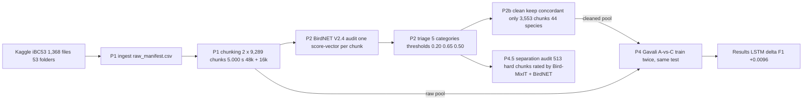

# Cleaning Crowdsourced Labels for Indian Bird Classification (iBC53)

**The thesis, in one line:** on the same model, the same seeded splits, and the same
held-out test, a classifier trained on **cleaned** data beats one trained on the
**raw** crowd-sourced data — even though cleaning removes 28% of the training set.
*Data quality beat data quantity.*

Result so far (Colab T4, Gavali-style audio-only LSTM): test Macro-F1 **0.3872 (A-raw)
→ 0.3968 (C-cleaned)**, accuracy **0.4402 → 0.4530**, delta **+0.0096 F1 / +0.0128 accuracy**.

This README is written so that someone who has never opened the code can understand:
what the data is, what the pipeline does, what every number means, where every figure
comes from, how to reproduce everything — and how to use it to build the paper.

---

## 1. The dataset

- **Source:** Kaggle dataset [`arghyasahoo/ibc53-indian-bird-call-dataset`](https://www.kaggle.com/datasets/arghyasahoo/ibc53-indian-bird-call-dataset)
  — Indian bird calls advertised as ~53 species / ~5,000 files.
- **Reality on disk:** `data/raw/ibc53/<species folder>/*.wav` — **1,368 files** across
  53 folders. Folder names are the (crowd-sourced, noisy) labels. One folder is literally
  `Mystery mystery/` (443 files) — no species label at all.
- Folder names follow an older taxonomy than BirdNET V2.4 (Clements 2024): 5 names are
  mapped via a `SYNONYMS` table in `src/audit.py`; 5 have no BirdNET counterpart at all
  (`Argya longirostris`, `Cyornis magnirostris`, `Sphenocichla humei`, `Chloropsis`,
  `Mystery mystery`) and stay `unlabeled` in the audit.

## 2. The pipeline (all stages, in run order)



| Stage | Script | What it does (frozen specs) |
|---|---|---|
| P1 ingest | `src/ingest.py` | scans `data/raw/ibc53/` → `data/raw_manifest.csv` (`filepath, species_name, recording_id, duration_s`); WAV-header durations only, no decode |
| P1 chunk | `src/chunking.py` | dual streams: **A** 48 kHz mono (BirdNET native), **B** 16 kHz mono; non-overlapping **5.0 s**; tails < 2.0 s dropped, tails in [2.0, 5.0) zero-padded and flagged (`padded_s`); IDs `<species>_<recording_id>_c<idx>` (zero-padded, e.g. `c003`) → `data/chunk_index.csv` |
| P2 audit | `src/audit.py` | BirdNET-Analyzer **V2.4 CPU**, sliding **3.0 s** windows (overlap 0.0), **max-pool** → one vector `S ∈ [0,1]^53` per chunk → `data/birdnet_scores/*.npz`; triage below → `data/audit_triage.csv` |
| P2 figure | `src/noise_figure.py` | Deliverable 1: per-species stacked noise bars (**BEFORE** figure; a measurement — never edited) |
| P2b clean | `src/clean.py` | keeps **only `concordant`** chunks → `data/iBC53-Cleaned-Metadata.csv` + **AFTER** figure (100% green by filtering) |
| P3 gold | `src/sample_gold.py` | stratifies a **150-chunk gold set** across 12 focus species (seed 42). **Locked, never used for anything** — kept as an eval-only carve-out (its chunk IDs are excluded *before* every later split) |
| P4 features | `src/gavali_features.py` | frozen acoustic adapter: 16 kHz → **MFCC (157 × 39)** (`n_mfcc=39, n_fft=1024, hop=512`), per-coefficient standardisation. (A frozen Log-Mel 128×157 CNN spec also exists in `agents.md` but is out of scope — see §9) |
| P4 splits | `src/gavali_splits.py` | recording-level stratified **80/10/10** (train/val/test), `random.Random(42)`, gold excluded first → `results/splits_by_recording.csv`, `splits_by_chunk.csv`, `splits_summary.json` |
| P4 compare | `src/gavali_compare.py` | **A vs C**: same model, same split, same test; only the *training pool* differs (raw vs cleaned). Backends: `sklearn` (local probe) and `lstm` (torch, Colab T4) |
| P4.5 separation audit | `src/separate_audit.py` | Bird-MixIT splits discarded multi-bird chunks into 4 isolated voices; BirdNET re-scores each voice; "dominant bird" verdict vs folder label (§6) |

### Triage rules (frozen — do not "improve" them)

| Category | Rule | Actual count (9,289 chunks) |
|---|---|---|
| empty / ambient | max(S) < 0.20 | 1,575 (17.0%) |
| intruder / co-occurrence | argmax(S) ≠ folder label **and** max ≥ 0.65 | 22 (0.2%) |
| concordant / target present | argmax(S) == folder label **and** max ≥ 0.50 | 3,553 (38.2%) |
| ambiguous | everything else | 501 (5.4%) |
| unlabeled | folder has no BirdNET label | 3,638 (39.2%) |

**Cleaning = filtering, not figure-editing.** The raw audit figure stays a raw
measurement; the all-green figure is produced by *keeping only concordant chunks*.
The cleaned set keeps 3,553 / 9,289 chunks (38.2%) across **44 species**; **9 species
lose every chunk** (they had zero concordant audio and vanish from the cleaned set).

## 3. Scope decisions (and why)

- **Focus-11 species** used by Gavali-style experiments: `Pellorneum ruficeps`,
  `Cuculus micropterus`, `Arborophila torqueola`, `Pomatorhinus ruficollis`,
  `Glaucidium cuculoides`, `Cyornis unicolor`, `Pnoepyga pusilla`,
  `Liocichla phoenicea`, `Rimator malacoptilus`, `Psilopogon lineatus`,
  `Psittacula eupatria` — the most frequent, genera-distinct, BirdNET-labelable
  species (focus-12 minus `Sphenocichla humei`, which is unauditable).
- **No human grading anywhere.** The project deliberately does *not* ask a human to
  listen and label. BirdNET is the rater throughout — an unsupervised,
  rater-independent audit. The 150-sample grading that was replaced is documented as
  `data/gold_test_150.csv` (locked; grades blank; **excluded from every split and
  every training set** — asserted twice in code). A 30-clip sampler
  (`src/spotcheck.py` → `results/spotcheck_30.csv`, 2 clips/species + 8 extra)
  exists as the would-have-been spot-check; it is **ungraded by decision** and must
  be declared so in the paper's limitations.
- **Honest test design:** C-cleaned is *not* tested on cleaned-only audio (that would
  be circular). Both A and C are evaluated on the **same 234 raw test chunks** (all
  label-usable chunks in the held-out test recordings).

## 4. Split definitions (source of truth: `results/splits_summary.json`)

| Pool | Definition | Train | Val | Test |
|---|---|---:|---:|---:|
| raw11_nogold | focus-11 chunks with triage ≠ unlabeled (gold IDs excluded first) | 2,563 | 412 | **234** |
| cleaned11_nogold | focus-11 chunks with triage == concordant (gold IDs excluded) | 1,837 | 259 | 172 |

The test set for **both** A and C: the 234 raw chunks in the test recordings.
`results/splits_by_chunk.csv` is the canonical per-chunk membership file; regenerating
splits with the same seed is byte-identical (deterministic).

## 5. The model

`src/gavali_compare.py --backend lstm` (adaptation of Gavali & Banu 2025's audio
branch, trained locally too, paper numbers only from this backend):

- Input: MFCC sequence `(157, 39)` per 5.0 s chunk
- `nn.LSTM(input 39, hidden 128, num_layers 1)` → final hidden state →
  `Dropout(0.2)` → `Linear(128 → 11)`
- Optimizer `RMSprop(lr=0.001)`, `CrossEntropyLoss`, batch **64**, **30 epochs**,
  CUDA (Colab T4)
- Seed 42 everywhere (torch, numpy, random, DataLoader generator)

## 6. Results (all numbers recomputed & re-verified from the files in this repo)

### 6.1 Headline ablation (`results/gavali_ablation.csv` — paper numbers)

```text
run       split  n_train  n_eval  accuracy  macro_f1
A-raw     test      2563     234    0.4402    0.3872
C-cleaned test      1837     234    0.4530    0.3968
```

**Delta (C − A) = +0.0096 Macro-F1, +0.0128 accuracy — with C trained on 28% less data.**
Quality over quantity is the story; +1 point is *not* the aspirational 4–7% from the
original plan — the paper must report it honestly (see §8).

The other ablation files are internal and **must never be quoted as results**:
- `gavali_ablation_sklearn.csv` — local sklearn mean-pool probe (A F1 0.0886,
  C 0.077, delta −0.0116): too weak an architecture to conclude anything;
  kept only as a sanity run. Paper numbers come **only** from the LSTM backend.
- `gavali_ablation_smoke.csv` — 3-minute pipeline smoke test (`--smoke` suffix
  guards paper files).

### 6.2 Per-species recall, LSTM A-raw → C-cleaned (same 234 test chunks)

| Species | n | recall (A-raw) | recall (C-cleaned) | Δ |
|---|---:|---:|---:|---:|
| Pellorneum ruficeps | 70 | 0.37 | 0.51 | **+0.14** |
| Pnoepyga pusilla | 13 | 0.15 | 0.38 | **+0.23** |
| Psilopogon lineatus | 5 | 0.00 | 0.40 | **+0.40** |
| Pomatorhinus ruficollis | 24 | 0.50 | 0.62 | **+0.12** |
| Cuculus micropterus | 25 | 0.72 | 0.76 | +0.04 |
| Liocichla phoenicea | 12 | 0.42 | 0.42 | 0.00 |
| Rimator malacoptilus | 6 | 0.50 | 0.50 | 0.00 |
| Psittacula eupatria | 28 | 0.29 | 0.18 | −0.11 |
| Cyornis unicolor | 29 | 0.55 | 0.38 | −0.17 |
| Glaucidium cuculoides | 9 | 0.56 | 0.33 | −0.22 |
| Arborophila torqueola | 13 | 0.62 | 0.15 | −0.46 |

Reading: the two biggest gains are on the **largest class** (n=70) and on a class that
A nearly failed (n=13); the losses are small-n classes where a couple of chunks flip
the recall. Disclose both sides; never cherry-pick.

(Zero recall baseline exists: `Psilopogon lineatus` went 0.00 → 0.40 on n=5.)

### 6.3 P4.5 separation audit — rating the 513 discarded chunks

The 523 chunks cleaning discards as intruder (22) or ambiguous (501) are exactly the
multi-bird moments. `src/separate_audit.py` (Bird-MixIT 4-source separation →
per-voice BirdNET scoring) rated them with **no human listening**:

- unfolded rule: the **dominant bird** of a chunk = the species whose BirdNET
  confidence is highest across the 4 separated voices (the max-activation-over-channels
  recipe of Denton et al. 2022); verdict `correct` if that species == folder label,
  `incorrect` otherwise, `no_dominant` if even the best voice scores < 0.20
  (the triage empty-floor);
- **513 chunks rated** (523 − 10 locked-gold chunks, excluded first);
- outcomes: **correct 217 / incorrect 62 / no_dominant 234** (verified from the
  committed shard CSVs);
- artifacts: `results/separation_523.shard{0..3}of4.csv` (513 rows, one per chunk,
  per-channel detail);
- the canonical merge (single CSV + summary JSON + `figures/separation_verdicts.*`)
  is **deferred by user choice** — running `python src/separate_audit.py --stage report`
  produces it in ~seconds (it merges the shard CSVs, dedupes, sorts, writes the
  figure, deletes the shard temp files).

The 2,052 isolated-voice WAVs live in `data/separated/` (git-ignored).

## 7. Figure inventory (what exists, what it shows, where it's from)

| Figure | File | Shows | Built by | Paper role |
|---|---|---|---|---|
| Fig. 1a (BEFORE) | `figures/noise_summary.png` / `.pdf` | raw per-species triage composition, sorted by corrupt share | `src/noise_figure.py` ← `audit_triage.csv` | the *measurement* — never edit |
| Fig. 1b (AFTER) | `figures/noise_summary_cleaned.png` / `.pdf` | same sampling grid after concordant-only filtering — 100% green by construction | `src/clean.py` | the *cleaning demonstration* |
| Fig. 3a | `figures/confusion_gavali_A.png` | LSTM A-raw confusion, 11×11, on the 234 test chunks | `src/gavali_compare.py --backend lstm` | model-level comparison |
| Fig. 3b | `figures/confusion_gavali_C.png` | LSTM C-cleaned confusion, same test | same | model-level comparison |
| (pending) Fig. 4 | `figures/separation_verdicts.png` | correct/incorrect/no_dominant split of the 513 rated chunks | `src/separate_audit.py --stage report` | rescue story (one command away) |
| (candidate) Fig. 2 | three named exemplars | spectrogram pairs: `Glaucidium cuculoides_1_c000` (concordant, conf 0.9682), `Glaucidium cuculoides_1_c002` (empty, 0.1363), `Dicrurus andamanensis_18_c001` (intruder → `Cuculus micropterus`, 0.9392) — all verified in `audit_triage.csv` | to be generated (librosa/soundfile + matplotlib) | concrete cleaning examples |

The `_sklearn` / `_smoke` variants of the confusion figures exist for internal
debugging and are **never** paper material.

## 8. Honest limitations (must appear in any write-up)

1. **BirdNET-concordant ≠ human-verified.** Every "clean" label is BirdNET's opinion;
   the whole audit is unsupervised and rater-independent (deliberate project decision).
2. **The 150-chunk gold set was never graded** (project decision). It remains locked
   and excluded; `results/spotcheck_30.csv` stayed ungraded.
3. **9 species vanish** from the cleaned set; `unlabeled` (39.2% of chunks) and the 5
   BirdNET-unmappable folders are excluded by construction — a coverage cost of
   strict cleaning.
4. **Test classes are small** (n = 5–70): per-species recall swings of ±0.2–0.5 are
   within a-few-chunks-flip noise. The macro number is the fair comparison.
5. **+1.0 point ≠ the aspirational 4–7%.** Report both: the goal predates the pivot to
   the Gavali LSTM + gold-free design; the achieved delta is +0.0096 F1 with 28% less
   training data.
6. Tails in [2.0, 5.0) s are **zero-padded** to exactly 5.0 s (flagged in
   `chunk_index.csv` via `padded_s`).
7. Taxonomy drift: 5 folder names mapped via synonyms; 5 folders are BirdNET-less and
   therefore `unlabeled`.
8. Separation caveats: Bird-MixIT needs **fp32** precision (TF32/fp16 audibly degrade
   it); sources are emitted at 22.05 kHz (below the 48 kHz audit stream, above the
   16 kHz model stream); **source order is not fixed** across chunks — hence the
   per-channel rescoring instead of channel indices.

## 9. How to reproduce everything

### Environment

- Local: Python **3.13.3** (Windows), `pip` packages: `librosa soundfile numpy pandas
  scikit-learn matplotlib tqdm` (+ `torch` CPU and `bird-mixit-pytorch` for the
  separation stage — installed 2026-10-22 with explicit user approval).
- Heavy audio never enters git (`.gitignore`): `data/raw/`, `data/chunks_48k/`,
  `data/chunks_16k/`, `data/birdnet_scores/`, `data/separated/`, `data/xc_refs/`.
- Small CSV artifacts at `data/` root **are** committed.
- On Colab: use the existing `GAVALI_RUNBOOK.md` top-to-bottom (T4 runtime; clone the
  repo; `pip install torch librosa soundfile scikit-learn matplotlib`; run
  `python src/gavali_compare.py --backend lstm --epochs 30 --device cuda`), then copy
  `results/` + confusion PNGs + `.pt` checkpoints back into the repo.

### Commands, in order

```text
# P1 (after kaggle.json is set up)
kaggle datasets download -d arghyasahoo/ibc53-indian-bird-call-dataset
python src/ingest.py
python src/chunking.py

# P2 (needs pip install birdnet_analyzer; Python >= 3.11)
python src/audit.py --stage all          # scores + triage (resume-safe)
python src/noise_figure.py               # Fig. 1a

# P2b
python src/clean.py                      # cleaned CSV + Fig. 1b

# P3
python src/sample_gold.py                # locks data/gold_test_150.csv

# P4 (Gavali audio-only)
python src/gavali_features.py --check    # expect: 3/3 chunks -> (157, 39) standardised
python src/gavali_splits.py              # expect: raw11 2563/412/234; cleaned11 1837/259/172
python src/spotcheck.py                  # 30-clip sampler (ungraded by decision)
python src/gavali_compare.py --backend sklearn --smoke   # ~2 min pipeline check
python src/gavali_compare.py --backend lstm --epochs 30 --device cuda  # PAPER NUMBERS

# P4.5 (separation audit; needs torch + bird-mixit-pytorch)
python src/separate_audit.py --stage all           # full 513-chunk run (resume-safe)
python src/separate_audit.py --stage report        # canonical CSV + summary + figure
```

### Pipeline verification checks ("make no mistakes" hardware)

- P1 DoD sweep: all 9,289 chunks in **both** streams are exactly 5.000 s; unique IDs;
  index ↔ directories match.
- `gavali_splits.py` + `gavali_compare.py` both **assert zero gold overlap**.
- `gavali_features.py --check` asserts grid shape (157, 39) and 5.0 s @ 16 kHz.
- `separate_audit.py` asserts summed sources == original mix (per chunk), source
  wav shapes, and that every rated row's folder label is BirdNET-mappable.
- BirdNET scoring of 22.05 kHz sources was probe-verified (known chunk scored
  0.9803 on resample) before the batch ran.
- `src/chunking.py` note: the module was renamed from `chunk.py` because that name
  shadowed Python's stdlib `chunk` (broke `librosa` on Python 3.11+ environments);
  never create `src/chunk.py` again.

## 10. Repo layout (what actually exists)

```text
indian-bird-audio-denoising/
├── agents.md                    # frozen specs, golden rules, phase plan (source of truth)
├── GAVALI_RUNBOOK.md            # step-by-step local + Colab run guide
├── suggestion.md                # best-outcome playbook for the paper
├── README.md                    # this file
├── .gitignore
├── .agents/                     # 14 per-prompt changelogs (mandatory discipline, §12)
├── src/
│   ├── ingest.py                # P1 manifest builder
│   ├── chunking.py              # P1 dual-stream chunker (renamed from chunk.py)
│   ├── audit.py                 # P2 BirdNET scores + triage (SYNONYMS map, resume-safe)
│   ├── noise_figure.py          # Deliverable 1 BEFORE figure
│   ├── clean.py                 # P2b concordant-only filter + AFTER figure
│   ├── sample_gold.py           # P3 locked gold sampler (FOCUS_12)
│   ├── gavali_features.py       # frozen MFCC adapter + FOCUS_11 list
│   ├── gavali_splits.py         # recording-level splits (seed 42, gold-first exclusion)
│   ├── gavali_compare.py        # A-vs-C runner (sklearn | lstm backends)
│   ├── spotcheck.py             # 30-clip ungraded-check sampler
│   ├── ibc53_loader.py          # torch Dataset over the cleaned CSV (open-science loader)
│   └── separate_audit.py        # P4.5 Bird-MixIT dominant-bird rating (sharded)
├── data/                        # committed small CSVs (+ gitignored heavy dirs)
│   ├── raw_manifest.csv         # 1,368 rows
│   ├── chunk_index.csv          # 9,289 rows (all chunk metadata)
│   ├── audit_triage.csv         # 9,289 rows (given/pred/conf/triage)
│   ├── birdnet_species_order.csv# the 53-species column order of S
│   ├── gold_test_150.csv        # LOCKED 150 rows (grades blank — by design)
│   └── iBC53-Cleaned-Metadata.csv # 3,553 rows / 44 species (the cleaned set)
├── figures/                     # noise pair + confusion pair (see §7)
└── results/                     # ablations, confusions, splits, spot-check, separation shards
```

`data/birdnet_scores/` (one `.npz` per chunk), `data/chunks_48k|16k/`, and
`data/separated/` exist locally but are git-ignored by size.

## 11. Related work & citations (for the paper's Related section)

- **Gavali & Banu (2025)**, *Front. Artif. Intell.* 8:1527299 (PMC11885287) — the
  image+audio dual-branch baseline on the **same Kaggle iBC53 dataset**; audio-only
  accuracy ≈ 82.5–84.3%. We reuse their audio branch (MFCC + LSTM) as a **frozen
  baseline** and change only the training data. Do not quote their accuracy against
  ours: different label counts (53 vs 11), features, and splits — the fair comparison
  is *our own* A-vs-C delta.
- **Denton, Wisdom & Hershey (2022)**, *Improving Bird Classification with
  Unsupervised Sound Separation*, ICASSP (arXiv:2110.03209) — Bird-MixIT; source of
  the separation stage and of the max-over-channels rule.
- **Wisdom et al. (2020)**, *Unsupervised Sound Separation Using Mixture Invariant
  Training*, NeurIPS — the MixIT training method behind Bird-MixIT.
- **Sasek et al. (2024)**, *PeerJ* (PMC11426315) — DSSS with BirdNET/PANN-assisted
  species-specific separation; the alternative approach we did *not* take because it
  requires training a separator.
- **BirdNET** (birdnet-team / BirdNET-Analyzer) — the V2.4 auditor; respect its
  license terms for the weights.
- **Sound separation checkpoints** — `matijama/bird-mixit-pytorch` (Apache 2.0 port of
  Google's Bird-MixIT; weight conversion verified against the TensorFlow original).
- **Dataset** — Kaggle `arghyasahoo/ibc53-indian-bird-call-dataset`; respect Kaggle/DU
  dataset terms. Optional reference clips: `data/xc_refs/` (Xeno-canto, git-ignored).

## 12. Changelog discipline (repo rule)

Every prompt that touches the repo adds `.agents/YYYY-MM-DD_<slug>.md`
(copy `.agents/_TEMPLATE.md`; one prompt = one file; never edit another prompt's
file). 14 files exist; the latest covers this README rewrite. `agents.md` remains the
frozen-spec source of truth: **seed 42 everywhere; thresholds 0.20 / 0.65 / 0.50;
5.0 s chunks; MFCC 157×39 for Gavali; Log-Mel 128×157 kept for a future CNN**.

## 13. Status & what's next

Current `main`: `faed123` — P1 ✅, P2 ✅ (Deliverable 1), P2b ✅, P3 ✅ (locked, unused
by design), P4-Gavali ✅ (LSTM paper numbers in), P4.5 ✅ (513 chunks rated; canonical
merge deferred, one command). Paper draft (P5, IEEEtran, Overleaf) and venue
submission (P6: ICIIS / ICECSP / early-2027 ICSC / SPICES; fallback Springer LNNS /
ICICC) are open.

Highest-value next steps, in order:

1. Run `python src/separate_audit.py --stage report` → canonical separation CSV +
   summary + `figures/separation_verdicts.png` (additive Fig. 4).
2. Regenerate the full LSTM ablation once with `--epochs 50` **only if** validation
   F1 was still climbing at epoch 30 (check the Colab log); otherwise keep 30-epoch
   results — a small honest delta beats a tuned one.
3. Draft the paper using §6 numbers + §7 figures + §8 limitations verbatim.
